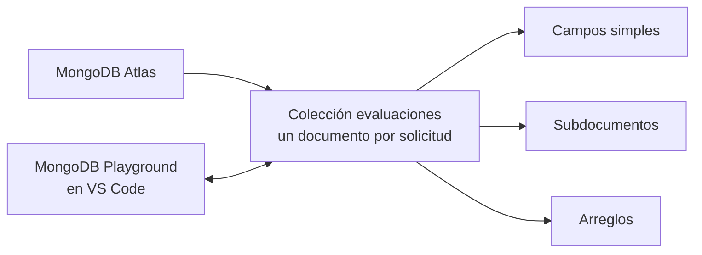
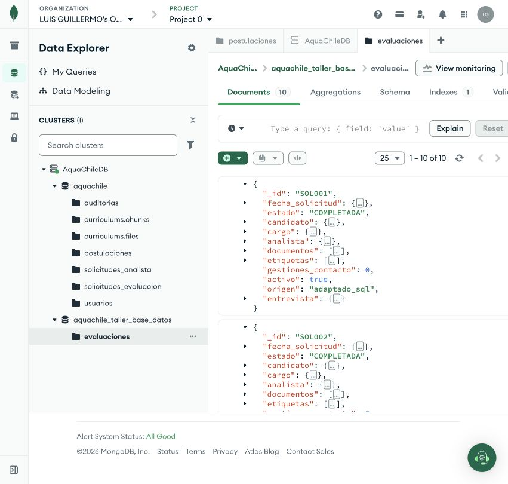

<div align="center">

# Evaluaciones Psicolaborales AquaChile

**Modelo documental en MongoDB para organizar fichas de evaluación y demostrar operaciones CRUD.**


</div>

---

## Descripción

Este proyecto adapta información de solicitudes de evaluación psicolaboral a MongoDB. Cada solicitud se guarda como un documento dentro de una sola colección, `evaluaciones`, para consultar juntos los datos del candidato, el cargo, los documentos y la entrevista.

La base de taller es `aquachile_taller_base_datos`. Es una adaptación académica aislada: **no reemplaza ni sincroniza la base Oracle del sistema original**.

## Modelo de datos

Cada documento combina campos simples, subdocumentos y arreglos:

- **Campos simples:** `_id`, `fecha_solicitud`, `estado`, `activo`, `origen` y `gestiones_contacto`.
- **Subdocumentos:** `candidato`, `cargo`, `analista` y `entrevista`.
- **Arreglos:** `etiquetas` y `documentos`. El arreglo `documentos` contiene subdocumentos con el tipo y la fecha de creación.

```js
{
  _id: "SOL001",
  estado: "COMPLETADA",
  activo: true,
  candidato: { nombre: "Pedro Martínez" },
  cargo: { nombre: "Analista de Datos", familia: "Tecnología" },
  etiquetas: ["origen_sql", "taller"],
  documentos: [
    { tipo: "CV", fecha_creacion: ISODate("2026-09-01T00:00:00Z") }
  ],
  entrevista: {
    psicologo: { nombre: "Carolina Silva" },
    informe: { estado: "COMPLETADO" }
  }
}
```

Cuando una solicitud aún no tiene entrevista, `entrevista` guarda `null`. Los documentos asociados en la ficha son metadatos; los PDF no se guardan en esta colección.

### Diagrama del proyecto



## Colección en Atlas

La captura muestra la colección `evaluaciones` con 10 documentos en la base aislada del taller.



## Archivos incluidos

| Archivo | Descripción |
| --- | --- |
| `01_carga.mongodb.js` | Crea la colección, define validación e índices, e inserta los datos de ejemplo para una instalación nueva. |
| `02_consultas.mongodb.js` | Consultas de solo lectura con rangos, listas, subdocumentos, proyección, orden y límite. |
| `03_crud_demostracion.mongodb.js` | Ejemplos de creación, actualización, consulta y eliminación para ejecutar en Playground. |
| `evaluaciones.json` | Copia de los datos en Extended JSON. |
| `carga_atlas.jpg` | Evidencia visual de la colección cargada en Atlas. |
| `README.md` | Descripción, modelo, diagrama e instrucciones del proyecto. |

## Operaciones incluidas

### Create

- `insertOne()` crea una ficha de prueba.
- `insertMany()` carga el lote inicial de 10 fichas en el script de carga y agrega dos fichas de prueba en la demostración CRUD.

### Read

Los archivos de consulta muestran filtros por rango (`$gte`, `$lte`), listas (`$in`, `$nin`, `$all`), campos anidados, `$or`, proyección, `sort()`, `limit()` y `distinct()`.

### Update

La demostración usa `updateOne()` y `updateMany()`, junto con `$set`, `$inc` y `$unset`, para cambiar estados, sumar gestiones y retirar un campo temporal.

### Delete

`deleteOne()` y `deleteMany()` borran solo fichas de demostración identificadas con `origen: "demo_crud"` y códigos `DEMO-E3-*`.


## Puesta en marcha y ejecución

1. Abre el proyecto en VS Code y conecta la extensión MongoDB al cluster de Atlas.
2. Selecciona la base `aquachile_taller_base_datos` en el Playground. Los scripts comprueban que la base seleccionada sea la correcta.
3. Para revisar consultas individuales, ejecuta los ejemplos de `02_consultas.mongodb.js`.
4. Para la demostración, abre `03_crud_demostracion.mongodb.js` y ejecuta los bloques en orden. Revisa el resultado de cada operación en Playground.


## Equipo

- Benjamín Agüero
- Luis Fermín
- Raúl Ferrini

**Asignatura:** BDY1103 — Taller de Base de Datos  
**Evaluación:** 3 · 2026

